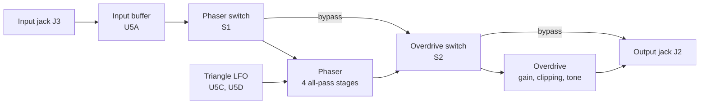

# Phaser and Overdrive Guitar Pedal

This project attempts to recreate and improve upon popular guitar pedals such as the MXR Phase 90 and the BOSS OD-1 by incorporating modern analog circuit design and PCB design.

[](LICENSE)


<p align="center">
  
  <br>
  <em>Final project PCB layout (KiCad 3D view).</em>
</p>

For the overdrive I also borrowed from the Ibanez Tube Screamer. This repository includes an LTspice schematic along with the 3rd party TL072 model it uses, and a KiCad project where both effects, the power supply and two footswitches sit on one 4-layer board sized for a Hammond 1590BB enclosure.

## Features

- Four-stage JFET phaser swept by an on-board LFO (Rate, Depth).
- OD-1 / Tube Screamer-style diode-clipping overdrive (Gain, Tone).
- Buffered input and a separate DPDT footswitch for each effect, phaser first.
- Runs off one DC jack: on-board ±4.5 V rails, plus reverse-polarity and surge protection.
- 85.5 mm × 110.75 mm 4-layer PCB with TVS protection on both audio jacks.

## Hardware

### Signal flow



### Main parts

| Part | Role |
| --- | --- |
| U1 TPS560430 buck converter | DC input to +5.5 V |
| U2 LM2662 charge pump | +5.5 V to −5.5 V |
| U3 TPS72301, U4 TPS7E82 LDOs | −4.5 V and +4.5 V rails |
| U5–U7 TL074 quad op-amps | Buffers, LFO, phaser, overdrive |
| Q1–Q4 J113 JFETs | Voltage-controlled resistors in the phaser |
| D1 CUS520 Schottky, D2–D4 20 V TVS | Reverse-polarity, surge and ESD protection |
| D5–D8 MUR260RLG | Overdrive clipping diodes |
| VR1–VR4 PTV09A pots, RV1/RV2 3386P trimmers | Controls (see below) |
| S1, S2 SF12011F DPDT footswitches | Phaser and overdrive on/off |
| J1 2.1 × 5.5 mm DC jack, J2/J3 MJ-63022A 6.35 mm jacks | Power, output, input |

### Controls

| Control | Ref | Value | What it does |
| --- | --- | --- | --- |
| Rate | VR1 | 1 MΩ linear | LFO speed |
| Depth | VR2 | 1 MΩ linear | Amount of phase-shifted signal in the mix |
| Tone | VR3 | 20 kΩ log | Active tone control |
| Gain | VR4 | 1 MΩ log | Overdrive feedback resistance |
| LFO offset trimmer | RV1 | 500 kΩ | LFO DC level (J113 bias) |
| LFO hysteresis trimmer | RV2 | 220 kΩ | LFO amplitude and frequency |

## Circuit

<p align="center">
  
  <br>
  <em>Preview of the circuit in LTspice (<code>LTSpice/Schematic.asc</code>).</em>
</p>

The notes below use KiCad's reference designators (LTspice uses different ones). The LTspice model uses the same topology and values, except every pot is linear, the tone pot is 1 MΩ (KiCad: 20 kΩ) and the clipping diodes are 1N4007 (KiCad: MUR260RLG). It also has no footswitches, uses ideal ±4.5 V sources for the supply, and feeds the phaser and the overdrive from the same input with separate outputs.

### Power supply

- The schematic gives 9–18 V as the expected DC input. D1 (Schottky, in series) blocks reverse polarity, and D2 (20 V TVS) shunts surges to ground.
- U1 (buck) makes +5.5 V, and U2 (charge pump) inverts it to an unregulated −5.5 V.
- U4 and U3 (LDOs) bring these down to ±4.5 V. Every TL074 has 100 nF decoupling on each rail.

### Input buffer and bypass

- C14 (1 µF) AC-couples the input jack tip into U5A, a voltage follower. R9 (1 MΩ) sets the input impedance and DC bias, and D4 clamps ESD on the tip.
- Each footswitch is a DPDT through/around selector. NC_1 and NC_2 are tied together, so when an effect is off the signal skips it.
- U5A stays in the path even with both effects off.

### LFO

- U5C is a Schmitt trigger whose output charges and discharges C16 (4.7 µF) through the Rate pot. RV2 sets the hysteresis. The annotated range is about 0.185 Hz to 12.2 Hz.
- U5D amplifies the C16 voltage into `TriangleOut`, which drives all four JFET gates (test pad TP3). RV1 sets its DC offset to bias the J113s (cut-off −0.5 V to −3.0 V per the LTspice note).

### Phase shifter

- U6A buffers the input and feeds the all-pass chain and the dry path.
- Four all-pass stages (U7A–U7D) each have a J113 across a 56 kΩ resistor to ground. As the LFO moves the gate, the JFET's resistance changes, and so does the stage's phase-shift frequency.
- U6B sums the dry signal with the shifted signal from the Depth pot. Where they're out of phase they cancel, which creates the notches.
- The LTspice notes put the two notches at 53.5 Hz and 311.9 Hz for R = 56 kΩ and C = 22 nF. They move up when the JFETs conduct, since that lowers the effective resistance across R.

### Overdrive

- U6C is a non-inverting gain stage with R29 (56 kΩ) plus the Gain pot as feedback, and C28 (82 pF) and two anti-parallel diode pairs (D5–D8) across it.
- Mid-band gain is about 6.6× to 107×, with the boosted band's lower corner at about 723 Hz (R30 10 kΩ, C30 22 nF).
- Past two diode drops, the diodes conduct and soft-clip the signal inside the feedback loop.
- A passive 723 Hz RC low-pass feeds the tone stage U6D, labelled in LTspice as an active high-pass (3.288 kHz at wiper = 1).

## Getting started

You'll need KiCad 10.0 or newer, LTspice and your own LTspice potentiometer model. The schematic loads `potentiometer.sub`, which is **not** included in this repo.

### How to import 3rd party models in LTspice

1. Download the .sub and .asy files found in the `LTSpice/3rdParty/` folder.
2. Place the files in your local LTspice directory, where the .sub files go into the `sub` folder and the .asy files go into the `sym` folder. The schematic places the op-amp as `OpAmps\TL072`, so `sym/OpAmps/` matches that path.
3. Add your potentiometer model the same way.
4. Open `LTSpice/Schematic.asc` and run it (a 15 s `.tran` with a 100 mV, 100 Hz test tone). Probe `InputSignal`, `TriangleOut`, `SignalOutPhaser` and `SignalOutOD`.
5. For a frequency response, turn the commented `.ac` line into a SPICE directive and comment out `.tran`.

Note: 3rd party models might get deleted once LTspice gets updated, so it's recommended to have a separate folder containing all your 3rd party models and then manually copy each file into the directory.

### How to import 3rd party libraries into KiCad

`KiCAD/GuitarPedalV4.kicad_pro` opens in KiCad 10 without these libraries, since the schematic and board embed every symbol and footprint. You only need them to edit parts.

1. Extract the two zip files in `KiCAD/Libraries/` into a directory of your choosing.
2. To import symbols, go into the symbol editor, click on the Preferences tab and head to Manage Symbol Libraries. Then click the folder icon, go to where you extracted the files and import the ones ending in .kicad_sym. This design uses the five `1_...` files, `Chassis` (inside `Chassis.pretty/`) and `SamacSys_Parts`. Keep each file name as its nickname so it matches the schematic.
3. For footprints, go into the footprint editor, click on the Preferences tab and head to Manage Footprint Libraries. Then click the folder icon and add the `Chassis.pretty` and `SamacSys_Parts.pretty` folders (footprint libraries are folders, not single .kicad_mod files).
4. The 3D models for the custom parts point to absolute paths on my machine, so they won't load on their own. Re-point each one under Footprint Properties > 3D Models to the STEP files in the extracted `SamacSys_Parts.3dshapes/` and `Chassis.pretty/3D Files/` folders.

## Repository structure

```text
.
├── KiCAD/
│   ├── GuitarPedalV4.kicad_pro      # KiCad 10 project
│   ├── GuitarPedalV4.kicad_sch      # Root sheet
│   ├── PowerSupply.kicad_sch        # Power supply
│   ├── Analog.kicad_sch             # Buffer, LFO, phaser, switches, jacks
│   ├── Overdrive.kicad_sch          # Overdrive sub-sheet
│   ├── GuitarPedalV4.kicad_pcb      # 4-layer PCB
│   └── Libraries/                   # DIY and SamacSys library zips
├── LTSpice/
│   ├── Schematic.asc                # Full circuit with design notes
│   └── 3rdParty/                    # TL072 model and symbol
├── LICENSE
└── README.md
```

## Sample simulations

<p align="center">
  
  <br>
  <em>Transient analysis (15 s, 100 mV 100 Hz tone). Top to bottom: input, LFO (about 0 V to −1.8 V, period about 5.4 s), phaser output, overdrive output (limited to about ±0.7 V).</em>
</p>

<p align="center">
  
  <br>
  <em>AC analysis, 20 Hz to 200 kHz (solid is magnitude, dotted is phase). The phaser output shows its two notches.</em>
</p>

## Credits

- Circuit design, simulation and PCB layout by Oscar Bazylewich.
- Inspired by the MXR Phase 90, BOSS OD-1 and Ibanez Tube Screamer.
- TL072 LTspice model: third-party macromodel (`tl072.sub`, created with PARTS release 4.01).
- Credits to SamacSys for the KiCad symbols, footprints and 3D models of the J113, MJ-63022A, PTV09A, 3386P and SF12011F parts.
- Enclosure: Hammond 1590BB.

## License

Released under the GNU General Public License v3.0. See [LICENSE](LICENSE).
