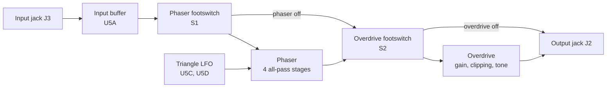

# Phaser and Overdrive Guitar Pedal

This project tries to make better equivalents of guitar pedals that many guitar players use, for example the MXR Phase 90 and the BOSS OD-1. For this, the project uses new methods of analog circuit design and PCB design. For the overdrive, the project also uses some circuit methods from the Ibanez Tube Screamer.

[](LICENSE)


<p align="center">
  
  <br>
  <em>The last PCB layout of the project (KiCad 3D view).</em>
</p>

This repository contains these items:

- An LTspice schematic, with the third-party TL072 model that the schematic uses.
- A KiCad project. In this project, the two effects, the power supply and two footswitches are on one 4-layer PCB. The PCB has the correct dimensions for a Hammond 1590BB enclosure.

## Features

- A JFET phaser with four all-pass stages (Rate, Depth). An LFO on the PCB modulates the phaser.
- An overdrive with diode clipping, of the OD-1 and Tube Screamer type (Gain, Tone).
- An input buffer, and one DPDT footswitch for each effect. The signal goes through the phaser first.
- One DC jack supplies the power. The PCB makes the ±4.5 V rails. It also has reverse-polarity protection and surge protection.
- An 85.5 mm × 110.75 mm 4-layer PCB, with TVS protection on the two audio jacks.

## Hardware

### Signal flow



### Primary parts

| Part | Function |
| --- | --- |
| U1 TPS560430 buck converter | DC input to +5.5 V |
| U2 LM2662 charge pump | +5.5 V to −5.5 V |
| U3 TPS72301, U4 TPS7E82 LDOs | −4.5 V and +4.5 V rails |
| U5–U7 TL074 quad op-amps | Buffers, LFO, phaser, overdrive |
| Q1–Q4 J113 JFETs | Voltage-controlled resistors in the phaser |
| D1 CUS520 Schottky, D2–D4 20 V TVS | Reverse-polarity, surge and ESD protection |
| D5–D8 1N4148 | Overdrive clipping diodes |
| VR1–VR4 PTV09A potentiometers, RV1/RV2 3386P trimmers | Controls (refer to the next table) |
| S1, S2 SF12011F DPDT footswitches | Phaser and overdrive on/off |
| J1 2.1 × 5.5 mm DC jack, J2/J3 MJ-63022A 6.35 mm jacks | Power, output, input |

### Controls

| Control | Ref | Value | Function |
| --- | --- | --- | --- |
| Rate | VR1 | 1 MΩ linear | LFO frequency |
| Depth | VR2 | 1 MΩ linear | Level of the phase-shifted signal in the mixed output |
| Tone | VR3 | 20 kΩ log | Tone control (active filter) |
| Gain | VR4 | 1 MΩ log | Overdrive feedback resistance |
| LFO offset trimmer | RV1 | 500 kΩ | LFO DC level (J113 bias) |
| LFO hysteresis trimmer | RV2 | 220 kΩ | LFO amplitude and frequency |

## Circuit

<p align="center">
  
  <br>
  <em>The circuit in LTspice (<code>LTSpice/Schematic.asc</code>).</em>
</p>

The sections that follow use the KiCad reference designators. The LTspice schematic uses different reference designators.

The LTspice schematic has the same topology and the same values as the KiCad schematic, with these differences:

- All the potentiometers are linear.
- The Tone potentiometer is 1 MΩ (KiCad: 20 kΩ).
- The clipping diodes are 1N4007 (KiCad: 1N4148).
- There are no footswitches.
- Ideal ±4.5 V sources supply the power.
- The same input signal goes to the phaser and to the overdrive. The phaser and the overdrive have different outputs.

### Power supply

- The KiCad schematic gives 9–18 V as the range for the DC input. D1 (Schottky, in series) gives reverse-polarity protection. D2 (20 V TVS) sends surges to ground.
- U1 (buck converter) makes +5.5 V. U2 (charge pump) changes this voltage to an unregulated −5.5 V.
- U4 and U3 (LDOs) decrease these voltages to ±4.5 V. Each TL074 has 100 nF decoupling capacitance on each rail.

### Input buffer and footswitches

- C14 (1 µF) connects the tip of the input jack to U5A through AC coupling. U5A is a voltage follower.
- R9 (1 MΩ) sets the input impedance and the DC bias. D4 gives ESD protection on the tip.
- Each footswitch is a DPDT selector. It sends the signal through the effect, or it bypasses the effect.
- NC_1 and NC_2 are connected together. Thus, when an effect is off, the footswitch bypasses that effect.
- When the two effects are off, U5A stays in the signal path.

### LFO

- U5C is a Schmitt trigger. The output of U5C charges and discharges C16 (4.7 µF) through the Rate potentiometer.
- RV2 sets the hysteresis. The LTspice notes give an LFO frequency range of approximately 0.185 Hz to 12.2 Hz.
- U5D amplifies the voltage on C16 and makes the `TriangleOut` signal. `TriangleOut` goes to the gates of all four JFETs (test pad TP3).
- RV1 sets the DC offset of `TriangleOut`. This offset sets the bias of the JFETs. The LTspice notes give a J113 cut-off voltage of −0.5 V to −3.0 V.

### Phaser

- U6A is the phaser buffer. The output of U6A goes to the all-pass stages and to the dry path.
- There are four all-pass stages (U7A–U7D). Each stage has a J113 JFET across a 56 kΩ resistor to ground.
- When the LFO changes the gate voltage, the resistance of the JFET changes. Thus, the phase-shift frequency of the stage also changes.
- U6B adds the phase-shifted signal from the Depth potentiometer to the dry signal. At some frequencies, the two signals are out of phase. At these frequencies, phase cancellation occurs. This phase cancellation makes the notches.
- The LTspice notes show the two notches at 53.5 Hz and 311.9 Hz (R = 56 kΩ, C = 22 nF).
- When current flows through the JFETs, the frequencies of the notches increase. This occurs because the JFETs decrease the total resistance across R.

### Overdrive

- U6C is a non-inverting gain stage. R29 (56 kΩ) plus the Gain potentiometer is the feedback resistance. C28 (82 pF) and two anti-parallel diode pairs (D5–D8) are across this resistance.
- The mid-band gain is approximately 6.6× to 107×. The lower corner frequency of the amplified band is approximately 723 Hz (R30 10 kΩ, C30 22 nF).
- When the signal voltage is more than the total forward voltage of two diodes, current flows through the diodes. The diodes then give soft clipping of the signal in the feedback loop.
- The signal then goes through a passive RC low-pass filter (723 Hz) to the tone stage U6D. The LTspice schematic identifies this tone stage as an active high-pass filter (3.288 kHz at wiper = 1).

## How to start

These items are necessary:

- KiCad 10.0 or a newer version.
- LTspice.
- An LTspice potentiometer model. You must supply this model.

The LTspice schematic loads `potentiometer.sub`. This repository does **not** include this file.

### How to import third-party models into LTspice

1. Download the .sub and .asy files from the `LTSpice/3rdParty/` folder.
2. Put the files in your local LTspice folder:
   - Put the .sub files in the `sub` folder.
   - Put the TL072 .asy file in the `sym/OpAmps/` folder, because the LTspice schematic identifies the op-amp as `OpAmps\TL072`.
   - Put all other .asy files in the `sym` folder.
3. Put the files of your potentiometer model in the folders of step 2.
4. Open `LTSpice/Schematic.asc`.
5. Start the simulation (a 15 s `.tran` with a 100 mV, 100 Hz test tone).
6. Use the probe to show the waveforms of `InputSignal`, `TriangleOut`, `SignalOutPhaser` and `SignalOutOD`.
7. To show the frequency response, do these steps:
   1. Change the `.ac` comment line to a SPICE directive.
   2. Change the `.tran` directive to a comment.
   3. Start the simulation again.

**Note:** When you update LTspice, LTspice can delete the third-party models.

To keep your third-party models, do these steps:

1. Keep a copy of all your third-party .sub and .asy files in a different folder (not in your local LTspice folder).
2. After you update LTspice, manually copy these files into the same folders as in step 2 of "How to import third-party models into LTspice".

### How to import third-party libraries into KiCad

You can open `KiCAD/GuitarPedalV4.kicad_pro` in KiCad 10 without these libraries. This is possible because the KiCad schematic and the PCB file contain all the symbols and footprints. These libraries are necessary only when you edit parts.

1. Extract the two ZIP files in `KiCAD/Libraries/` into a folder that you select.
2. To import the symbols, do these steps:
   1. Open the symbol editor.
   2. Click the **Preferences** menu.
   3. Select **Manage Symbol Libraries**.
   4. Click the folder icon.
   5. Navigate to a folder that contains .kicad_sym files.
   6. Import the .kicad_sym files in this folder.
   7. Keep each file name as its nickname, because the KiCad schematic uses these names.
   8. If other folders contain .kicad_sym files, do steps 4 to 7 again for each of these folders.

   **Note:** The KiCad project uses these .kicad_sym files: the five `1_...` files, `Chassis` (in `Chassis.pretty/`) and `SamacSys_Parts`.
3. To import the footprints, do these steps:
   1. Open the footprint editor.
   2. Click the **Preferences** menu.
   3. Select **Manage Footprint Libraries**.
   4. Click the folder icon.
   5. Add the `Chassis.pretty` and `SamacSys_Parts.pretty` folders. Each footprint library is a folder, not one .kicad_mod file.
4. If KiCad does not show the 3D models of the custom parts, change the paths of these 3D models:
   1. For each footprint of a custom part, navigate to **Footprint Properties > 3D Models**.
   2. Change the path to the related STEP file in the extracted `SamacSys_Parts.3dshapes/` or `Chassis.pretty/3D Files/` folder.

   **Note:** These 3D models use absolute paths on the computer of the designer.

## Repository structure

```text
.
├── KiCAD/
│   ├── GuitarPedalV4.kicad_pro      # KiCad 10 project
│   ├── GuitarPedalV4.kicad_sch      # Root sheet
│   ├── PowerSupply.kicad_sch        # Power supply
│   ├── Analog.kicad_sch             # Buffer, LFO, phaser, footswitches, jacks
│   ├── Overdrive.kicad_sch          # Overdrive sub-sheet
│   ├── GuitarPedalV4.kicad_pcb      # 4-layer PCB
│   └── Libraries/                   # ZIP files of the DIY and SamacSys libraries
├── LTSpice/
│   ├── Schematic.asc                # Full circuit with LTspice notes
│   └── 3rdParty/                    # TL072 model and symbol
├── LICENSE
└── README.md
```

## Simulation examples

<p align="center">
  
  <br>
  <em>Transient analysis (15 s, 100 mV, 100 Hz test tone). From top to bottom: input, LFO (approximately 0 V to −1.8 V, period approximately 5.4 s), phaser output, overdrive output (limit of approximately ±0.7 V).</em>
</p>

<p align="center">
  
  <br>
  <em>AC analysis, 20 Hz to 200 kHz (continuous line: magnitude, dotted line: phase). The phaser output shows its two notches.</em>
</p>

## Credits

- Oscar Bazylewich did the circuit design, the simulation and the PCB layout.
- This project uses the MXR Phase 90, the BOSS OD-1 and the Ibanez Tube Screamer as examples.
- TL072 LTspice model: third-party macromodel (`tl072.sub`, from PARTS release 4.01).
- SamacSys supplied the KiCad symbols, footprints and 3D models of the J113, MJ-63022A, PTV09A, 3386P and SF12011F parts.
- Enclosure: Hammond 1590BB.

## License

The license of this project is the GNU General Public License v3.0. Refer to [LICENSE](LICENSE).
