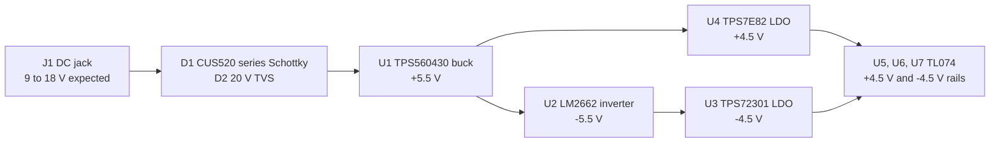

# Phaser and Overdrive Guitar Pedal

An analog guitar pedal that combines a JFET phaser and a diode-clipping overdrive, simulated in LTspice and laid out on a four-layer KiCad PCB sized for a Hammond 1590BB enclosure.

[](LICENSE)


<p align="center">
  
  <br>
  <em>KiCad 3D view of the final V1 board layout (<code>KiCAD/GuitarPedalV4.kicad_pcb</code>).</em>
</p>

## Overview

The project recreates two classic pedals, the MXR Phase 90 and the BOSS OD-1, and tries to improve on them with modern analog circuit design and PCB design. The overdrive also borrows from the Ibanez Tube Screamer. An LTspice model simulates the input buffer, the LFO and both effects. The KiCad project puts both effects, an on-board dual-rail power supply and two footswitches on one board, and takes the board outline from a 1590BB enclosure footprint.

### Features

- **Four-stage JFET phaser**: four TL074 all-pass stages, each tuned by a J113 JFET, are swept by an on-board LFO. Controls: Rate and Depth.
- **OD-1 / Tube Screamer-style overdrive**: a non-inverting gain stage with anti-parallel diode pairs in its feedback loop, followed by an RC low-pass filter and an active tone stage. Controls: Gain and Tone.
- **Independent bypass switching**: each effect has its own DPDT footswitch that sends the signal through the effect or around it. The phaser comes before the overdrive.
- **Input buffer**: a TL074 voltage follower with a 1 MΩ input bias resistor sits ahead of the switches.
- **On-board supply from one DC jack**: series Schottky reverse-polarity protection, a 20 V TVS, a 5.5 V buck converter, a charge-pump inverter and two LDOs together produce ±4.5 V for the op-amps.
- **ESD protection**: TVS diodes on both audio jack tips.
- **4-layer PCB**: 85.5 mm × 110.75 mm, with a ground pour on all copper layers. It mixes SMD parts (0603 resistors, SOIC and SOT-23 ICs) with through-hole parts (film capacitors, JFETs, pots, switches and jacks).

## Table of contents

- [Hardware](#hardware)
- [Circuit design](#circuit-design)
- [Getting started](#getting-started)
- [Repository structure](#repository-structure)
- [Simulation results](#simulation-results)
- [Credits](#credits)
- [License](#license)

## Hardware

### Signal flow

The audio path, taken from the KiCad netlist. Net names are the labels used in `KiCAD/Analog.kicad_sch` and `KiCAD/Overdrive.kicad_sch`.

```mermaid
flowchart LR
    J3["J3 input jack<br/>5_TipIN"] --> BUF["Input buffer<br/>U5A, C14 1 uF, R9 1 M"]
    BUF -- "5_SignalIN" --> S1A["S1 phaser switch<br/>pole 1 COM_1"]
    S1A -- "NO_1: 8_PhaserIN" --> PBUF["Phaser buffer<br/>U6A"]
    PBUF --> AP["4 all-pass stages<br/>U7A to U7D, Q1 to Q4 J113"]
    AP --> DEPTH["Depth pot<br/>VR2 1 M lin"]
    DEPTH --> MIX["Inverting summer<br/>U6B"]
    PBUF -- "dry, R11" --> MIX
    MIX -- "NO_2: 8_PhaserOUT" --> S1B["S1 pole 2<br/>COM_2"]
    S1A -- "NC_1 to NC_2: bypass" --> S1B
    S1B -- "S1 to S2" --> S2A["S2 overdrive switch<br/>pole 1 COM_1"]
    S2A -- "NO_1: 9_OverdriveIN" --> GAIN["Clipping gain stage<br/>U6C, D5 to D8, VR4 Gain"]
    GAIN --> LPF["RC low-pass<br/>R31 10 k, C32 22 nF"]
    LPF --> TONE["Tone stage<br/>U6D, VR3 Tone"]
    TONE -- "NO_2: 9_OverdriveOUT" --> S2B["S2 pole 2<br/>COM_2"]
    S2A -- "NC_1 to NC_2: bypass" --> S2B
    S2B -- "6_SignalOUT" --> J2["J2 output jack"]
    OSC["Relaxation oscillator<br/>U5C, VR1 Rate, C16 4.7 uF"] --> OFS["Offset amplifier<br/>U5D, RV1 500 k trim"]
    OFS -- "7_TriangleOut" --> AP
```



### Parts summary

These are the main parts on `KiCAD/GuitarPedalV4.kicad_pcb`. Part numbers and values come from the schematic.

| Ref | Part | Package / footprint | Role |
| --- | --- | --- | --- |
| U1 | TPS560430XFDBVR buck converter (36 V, 600 mA) | SOT-23-6 | VDC to +5.5 V |
| U2 | LM2662MX/NOPB switched-capacitor converter | SOIC-8 | +5.5 V to −5.5 V |
| U3 | TPS72301DBV negative LDO | SOT-23-5 | −5.5 V to −4.5 V |
| U4 | TPS7E8201DBVR LDO | SOT-23-5 | +5.5 V to +4.5 V |
| U5 | TL074 quad op-amp | SOIC-14 | Input buffer (A), LFO comparator (C), LFO offset amplifier (D); B unused |
| U6 | TL074 quad op-amp | SOIC-14 | Phaser buffer (A), phaser summer (B), overdrive gain (C), tone stage (D) |
| U7 | TL074 quad op-amp | SOIC-14 | Four all-pass stages (A to D) |
| Q1–Q4 | J113 N-channel JFET | TO-92 | Voltage-controlled resistors in the all-pass stages |
| D1 | CUS520,H3F Schottky diode (30 V, 200 mA) | SOD-323 | Series reverse-polarity protection |
| D2–D4 | D20V0L1B2WS-7 TVS diode (20 V working) | SOD-323 | DC input (D2), output tip (D3), input tip (D4) |
| D5–D8 | MUR260RLG | DO-35 axial | Overdrive clipping diodes |
| L1 | 22 µH inductor | 0805 | Buck converter inductor |
| VR1, VR2 | PTV09A-4020F-B105, 1 MΩ linear | PTV09A | Rate, Depth |
| VR3 | PTV09A-4025F-A203, 20 kΩ log | PTV09A | Tone |
| VR4 | PTV09A-4025F-A105, 1 MΩ log | PTV09A | Gain |
| RV1 | 3386P-1-504LF trimmer, 500 kΩ | 3386P | LFO DC offset |
| RV2 | 3386P-1-224LF trimmer, 220 kΩ | 3386P | LFO comparator hysteresis |
| S1, S2 | SF12011F-0202-20R-M-050 DPDT footswitch | SF12011F | Phaser and overdrive on/off |
| J1 | DC barrel jack, 2.1 × 5.5 mm (Würth 694106301002) | GCT DCJ200-10-A | Power input |
| J2, J3 | MJ-63022A 6.35 mm mono jack | MJ63022A | Output (J2), input (J3) |
| CASE1 | Hammond 1590BB (excluded from BOM) | Chassis:1590BB | Board outline and enclosure 3D model |
| H1–H4 | M3 mounting hole with pad | 3.2 mm | Mounting |
| TP1–TP3 | Test pad | 1.0 mm × 1.0 mm | −4.5 V, +4.5 V, TriangleOut |

Passives: R1–R32 are 0603 SMD resistors. The supply and decoupling capacitors are SMD parts (0603, 0805 and 1206). The audio-path capacitors (C14–C16, C19–C23, C28–C32) use through-hole film-capacitor footprints, plus ceramic-disc footprints for the two 82 pF capacitors.

### Controls

| Control | Ref | Value (schematic) | LTspice name | What it does | Board position (top view) |
| --- | --- | --- | --- | --- | --- |
| Rate | VR1 | 1 MΩ linear | Pot1-Linear | Variable charging resistance for the LFO timing capacitor C16 | Left, upper |
| Depth | VR2 | 1 MΩ linear | Pot4-Linear | Sets the level of the phase-shifted signal going into the summer | Left, lower |
| Tone | VR3 | 20 kΩ log | Pot6-Linear | Active tone control around U6D | Right, upper |
| Gain | VR4 | 1 MΩ log | Pot5-Log | Overdrive feedback resistance, in series with R29 56 kΩ | Right, lower |
| Phaser on/off | S1 | DPDT footswitch | – | Routes the signal through or around the phaser | Left, bottom |
| Overdrive on/off | S2 | DPDT footswitch | – | Routes the signal through or around the overdrive | Right, bottom |
| LFO offset (trim) | RV1 | 500 kΩ | Pot3-Linear | DC level of TriangleOut relative to the J113 cut-off range | Trimmer, right of U5 |
| LFO hysteresis (trim) | RV2 | 220 kΩ | Pot2-Linear | Comparator threshold, which sets the LFO amplitude and frequency | Trimmer, left of U5 |

There are four user pots. The board has no separate output-level control. LTspice models every pot as linear (see the note in `LTSpice/Schematic.asc`).

### Connectors and switch wiring

| Ref | Pin | Net | Connects to |
| --- | --- | --- | --- |
| J1 | 1 | +VDC | D1 anode, D2 |
| J1 | 2, 3 | GND | Ground |
| J3 (input) | T (2) | 5_TipIN | C14 and D4, then the U5A buffer |
| J3 (input) | S (1) | GND | Ground |
| J2 (output) | T (2) | 6_SignalOUT | S2 COM_2, D3 |
| J2 (output) | S (1) | GND | Ground |

| Footswitch pin | S1 (phaser) | S2 (overdrive) |
| --- | --- | --- |
| 1 NO_1 | 8_PhaserIN, to U6A + (pin 3) | 9_OverdriveIN, to U6C + (pin 10) |
| 2 COM_1 | 5_SignalIN, from U5A output | S1 to S2 |
| 3 NC_1 | 10_Bypass Phaser, tied to NC_2 | 10_Bypass OD, tied to NC_2 |
| 4 NO_2 | 8_PhaserOUT, from C19 / R22 | 9_OverdriveOUT, from C31 / R32 |
| 5 COM_2 | S1 to S2 | 6_SignalOUT, to J2 tip |
| 6 NC_2 | 10_Bypass Phaser | 10_Bypass OD |

Test pads: TP1 = −4.5 V, TP2 = +4.5 V, TP3 = 7_TriangleOut (the LFO output).

### PCB

- **Stack-up**: four copper layers. F.Cu and B.Cu are defined as mixed layers, and In1.Cu and In2.Cu as power layers. Total thickness is 1.547 mm: two 0.196 mm 7628 prepreg layers around a 1.03 mm FR4 core.
- **Outline**: 85.5 mm × 110.75 mm with notched corners. The outline is drawn on Edge.Cuts inside the `Chassis:1590BB` footprint (CASE1), which also carries a 1590BB enclosure STEP model. Four M3 mounting holes.
- **Copper**: a GND zone on all four copper layers, plus F.Cu zones for +VDC, +5.5 V, −5.5 V, +4.5 V and −4.5 V. There are 560 track segments (424 on F.Cu, 136 on B.Cu) and 168 vias. Track widths are 0.25, 0.3, 0.5 and 1.0 mm.
- **Net classes**: one per functional block (`1_Buck`, `2_UNS`, `3_RNS`, `4_RPS`, `5_IN`, `6_OUT`, `7_LFO`, `8_Phaser`, `9_OD`, `10_Bypass`, `PWR`, `GND`). The numbered classes are assigned from the numeric prefix of the net label, `PWR` matches the `+` and `-` rails, and `GND` matches the ground net.
- **Placement**: the power supply runs along the top edge next to J1. The jacks sit on the left and right sides, the phaser pots on the left, the overdrive pots on the right and the footswitches along the bottom. The silkscreen reads "Phaser and Overdrive Pedal V1".

## Circuit design

<p align="center">
  
  <br>
  <em>The full circuit in LTspice (<code>LTSpice/Schematic.asc</code>), annotated with the design equations.</em>
</p>

The LTspice model and the KiCad schematic use the same topology and different reference designators. The component values match, except that LTspice uses a 1 MΩ tone pot (KiCad: 20 kΩ) and 1N4007 clipping diodes (KiCad: MUR260RLG). This section uses the KiCad references. In LTspice the phaser and the overdrive are both fed from `InputSignal` and have separate outputs (`SignalOutPhaser`, `SignalOutOD`). The footswitches are not modelled, and the supply is idealised as ±4.5 V sources with 15 Ω series resistance.

### Power supply

`KiCAD/PowerSupply.kicad_sch`



- **Input and protection**: the schematic gives an expected input of 9–18 V. D1 (CUS520,H3F Schottky) sits in series with the supply and blocks reverse polarity. D2 (D20V0L1B2WS-7, 20 V working / 30 V clamping) shunts surges to ground. The schematic labels this block "ESD, Reverse Polarity, and Overvoltage Protection".
- **Buck converter**: U1 (TPS560430, 6–36 V in) produces 5.5 V. The parts are L1 22 µH, feedback divider R1 56 kΩ / R2 12.4 kΩ, bootstrap capacitor C1 100 nF, input capacitors C2 10 µF and C3 100 nF, and output capacitors C4 and C5 (10 µF each).
- **Negative rail**: U2 (LM2662 charge pump) inverts +5.5 V to an unregulated −5.5 V, using C9 47 µF as the flying capacitor and C10 47 µF at the output.
- **Linear regulators**: U4 (TPS7E82) regulates +5.5 V down to +4.5 V, and U3 (TPS72301) regulates −5.5 V to −4.5 V. Both use a 56 kΩ / 20 kΩ feedback divider (R5/R6 and R3/R4) with a 10 nF capacitor across the upper resistor (C12, C7).
- **Decoupling**: every TL074 has 100 nF decoupling on each rail (C17/C18, C24/C26, C25/C27).

### Input buffer and bypass switching

`KiCAD/Analog.kicad_sch`, "Input Signal" and "Bypass Foot Switches" blocks

- The input jack tip (J3) is AC-coupled through C14 (1 µF film) into U5A, which is wired as a voltage follower. R9 (1 MΩ to ground) sets the input impedance and DC bias. D4 clamps ESD on the tip.
- The buffered signal goes to S1 and then to S2. Each switch is wired as a DPDT through/around selector. In the NO position, pole 1 sends the signal into the effect and pole 2 takes the effect output to COM_2. In the NC position, NC_1 and NC_2 are tied together, so the signal skips the effect. The phaser output feeds the overdrive switch, and S2 COM_2 drives the output jack J2, which has its own TVS (D3).
- U5A stays in the signal path even when both effects are bypassed.

### Triangle LFO

`KiCAD/Analog.kicad_sch`, "Triangle LFO" block. LTspice U2 and U3.

- **Oscillator**: U5C is a comparator with positive feedback, i.e. a Schmitt trigger. Its hysteresis comes from R10 (56 kΩ to ground) and the trimmer RV2 (220 kΩ from the output, `7_SquareOut`). The square-wave output charges and discharges the timing capacitor C16 (4.7 µF film) through VR1 (1 MΩ linear, Rate). The capacitor voltage returns to the inverting input through R8 (20 kΩ), and C15 (82 pF) connects the output to that same input.
- **Offset amplifier**: U5D amplifies the voltage on C16. Its inverting input connects to R7 (56 kΩ feedback) and to the wiper of RV1 (500 kΩ trimmer between +4.5 V and ground). RV1 sets the DC offset of `7_TriangleOut`, which biases the J113 gates (the LTspice annotation lists a J113 V_GS cut-off of −0.5 V to −3.0 V). `TriangleOut` drives all four JFET gates directly and is brought out on TP3.
- **LTspice annotations**:
  - Frequency: f = 1 / (2 · ln(1 + 2·R2/Pot2) · (R3 + Pot1) · C2), which is R10, RV2, R8, VR1 and C16 on the PCB. The annotated design range is about 0.185 Hz to 12.2 Hz.
  - Amplitude: 1.77 V with the hysteresis trimmer wiper at 0.49.
  - Swing: −0.08 V to −1.85 V with the offset trimmer wiper at 0.3.

### Phase shifter

`KiCAD/Analog.kicad_sch`, "Phaser" block. Annotated in LTspice as "Design inspired by MXR Phase 90".

- **Buffer**: U6A buffers the phaser input (`8_PhaserIN`) and drives both the all-pass chain and the dry path.
- **All-pass stages**: four identical stages, U7A to U7D. Each has a 56 kΩ input resistor and a 56 kΩ feedback resistor on the inverting input (R17/R12, R18/R13, R19/R14, R20/R15). On the non-inverting input, a 22 nF film capacitor (C20–C23) feeds a 56 kΩ resistor to ground (R23–R26). The drain-source channel of a J113 (Q1–Q4) sits in parallel with that resistor, with the source grounded and the gate on `TriangleOut`. Each stage passes all frequencies at unity gain and shifts their phase. As the LFO moves the gate voltage, the channel resistance changes, and with it each stage's phase-shift frequency.
- **Mixing**: the output of the last stage (`8_U7DO`) drives VR2 (Depth), which is wired as a voltage divider to ground. Its wiper feeds R21 (56 kΩ) into the inverting summer U6B. The dry signal from U6A enters the same summer through R11 (56 kΩ), and R16 (56 kΩ) is the feedback resistor. Where the wet and dry signals are out of phase they cancel, which creates notches in the response.
- **Notch frequencies**: the LTspice annotation gives the two notches as f = tan(θ/2) / (2π·R·C), with θ = 45° and 135°. For R = 56 kΩ and C = 22 nF that is 53.5 Hz and 311.9 Hz. When a JFET conducts, it lowers the effective resistance in parallel with R, so the notches move up in frequency.
- **Output**: U6B drives `8_PhaserOUT` through C19 (1 µF), with R22 (1 MΩ) to ground.

### Overdrive

`KiCAD/Overdrive.kicad_sch`, a sub-sheet of the Analog sheet. Annotated in LTspice as "Design Inspired by BOSS OD-1 and Ibanez Tube Screamer".

- **Gain stage (U6C)**: the input (`9_OverdriveIN`) goes straight to the non-inverting input.
  - The feedback network is R29 (56 kΩ) in series with VR4 (1 MΩ log, Gain). C28 (82 pF) and two anti-parallel diode pairs (D5 + D6 and D7 + D8, two diodes in series in each direction) are connected in parallel with it.
  - In the ground leg, R30 (10 kΩ) in series with C30 (22 nF) sets the lower corner of the boosted band at 1/(2π·10 kΩ·22 nF) ≈ 723 Hz.
  - Mid-band gain is 1 + (R29 + VR4)/R30, about 6.6× to 107×.
  - According to the annotation, C28 limits the bandwidth to 34.7 kHz at minimum gain and 1.84 kHz at maximum gain.
  - Once the voltage across the feedback network exceeds two diode forward drops, the diodes conduct and soft-clip the signal inside the feedback loop. LTspice models the diodes as 1N4007.
- **Low-pass filter**: R31 (10 kΩ) and C32 (22 nF) form a passive low-pass filter at 723 Hz (annotated as 723.431 Hz) ahead of the tone stage.
- **Tone stage (U6D)**: R28 (10 kΩ) is the feedback resistor. VR3 (Tone) connects between the non-inverting and inverting inputs. Its wiper goes to ground through C29 (22 nF) and R27 (2.2 kΩ). The LTspice annotation labels this stage an active high-pass filter with a corner of 3.288 kHz at wiper = 1, which is 1/(2π·2.2 kΩ·22 nF). LTspice models the tone pot as 1 MΩ linear.
- **Output**: U6D drives `9_OverdriveOUT` through C31 (1 µF), with R32 (1 MΩ) to ground.

## Getting started

### Prerequisites

- KiCad 10.0 or newer. All design files were saved by KiCad 10.0.
- LTspice, to run the simulation.
- A potentiometer model for LTspice. The schematic loads one with `.inc potentiometer.sub` and places six `potentiometer` symbols with `Rtot` and `wiper` parameters, but that model is **not** included in this repository.

### Simulate in LTspice

1. Copy `LTSpice/3rdParty/sub/tl072.sub` into the `sub` folder of your local LTspice library directory.
2. Copy `LTSpice/3rdParty/sym/tl072.asy` into the `sym` folder. The schematic places the op-amp as `OpAmps\TL072`, so `sym/OpAmps/` matches that path.
3. Add your potentiometer model (`potentiometer.sub` in `sub`, `potentiometer.asy` in `sym`).
4. Open `LTSpice/Schematic.asc` and run it. The active directive is `.tran 0 15s 0s startup`. The input source is V3 = `SINE(0 1 100)` (1 V, 100 Hz), and B1 scales it by 1/10 to a 100 mV test signal. Probe `InputSignal`, `TriangleOut`, `SignalOutPhaser` and `SignalOutOD`.
5. To get a frequency response, turn the commented `.ac dec 67 20 200000` line into a SPICE directive and comment out `.tran`.
6. Optional: the commented `wavefile=` and `.wave` lines show how to drive the circuit with a recorded guitar WAV and export the outputs as audio. Supply your own WAV file and change the paths.

> **Tip:** LTspice updates can delete third-party models from its library folders. Keep a separate backup folder of all your third-party models and copy them back in by hand when needed.

### Open the KiCad project

1. Open `KiCAD/GuitarPedalV4.kicad_pro` in KiCad 10. The schematic and board embed copies of every symbol and footprint, so the project opens without extra libraries. You only need the steps below to edit or update parts.
2. Extract `KiCAD/Libraries/DIY Symbol_Footprint Library.zip` and `KiCAD/Libraries/Imported Symbol_Footprint Library.zip` into a directory of your choice.
3. Symbols: go to **Preferences > Manage Symbol Libraries**, click the folder icon (add existing library) and add these `.kicad_sym` files. Keep each file name as the library nickname so it matches the references in the schematic:
   - From the DIY library: `1_BuckConverters`, `1_LDORegulators`, `1_SchottkyDiodes`, `1_TVSDiodes`, `1_VoltageInverters`, and `Chassis` (located in `Chassis.pretty/`).
   - From the imported library: `SamacSys_Parts`.
4. Footprints: go to **Preferences > Manage Footprint Libraries** and add the `Chassis.pretty` and `SamacSys_Parts.pretty` folders. KiCad footprint libraries are `.pretty` folders, not individual `.kicad_mod` files.
5. 3D models for the custom parts (1590BB enclosure, J113, jacks, pots, trimmers, footswitch) point to absolute paths on the author's machine, so they will not load automatically. To see them in the 3D viewer, re-point each model under **Footprint Properties > 3D Models** to the STEP files in the extracted `SamacSys_Parts.3dshapes/` and `Chassis.pretty/3D Files/` folders.

#### Library contents

| Archive | Contents used by this design | Other contents |
| --- | --- | --- |
| DIY Symbol_Footprint Library.zip | Symbols for TPS560430XDBVR (buck), TPS7E82 (LDO), CUS520,H3F (Schottky), D20V0L1B2WS-7 (TVS) and LM2662 (inverter). 1590BB enclosure symbol, footprint and `1590BB_Enclosure_Top.STEP` model | TPS54202HDDCR, LDK220, TPS7A2450, BAT85S, ESD12VD3B, a Waveshare SPI LCD module, `.bak` backups |
| Imported Symbol_Footprint Library.zip | `SamacSys_Parts` symbols, footprints and STEP models for the J113 (TO-92 footprint `2N3904BU`), MJ-63022A jack, PTV09A pots, 3386P trimmer and SF12011F footswitch | Toggle switches, MJ-63022B, MMBFJ201, NE555DR, PDB12 and RV09AF pots, a 7447714 inductor, an extra STEP file |

## Repository structure

```text
.
├── KiCAD/
│   ├── GuitarPedalV4.kicad_pro        # KiCad 10 project (net classes, design rules)
│   ├── GuitarPedalV4.kicad_sch        # Root sheet: Power Supply Section + Analog Section
│   ├── PowerSupply.kicad_sch          # DC jack, protection, buck, charge pump, ±4.5 V LDOs
│   ├── Analog.kicad_sch               # Input buffer, LFO, phaser, footswitches, jacks, mechanical
│   ├── Overdrive.kicad_sch            # Overdrive sub-sheet (placed inside Analog.kicad_sch)
│   ├── GuitarPedalV4.kicad_pcb        # 4-layer PCB in a 1590BB outline
│   └── Libraries/
│       ├── DIY Symbol_Footprint Library.zip       # Custom symbols, 1590BB footprint + STEP
│       └── Imported Symbol_Footprint Library.zip  # SamacSys symbols, footprints, STEP models
├── LTSpice/
│   ├── Schematic.asc                  # Full LTspice circuit with design annotations
│   └── 3rdParty/
│       ├── sub/tl072.sub              # TL072 op-amp macromodel
│       └── sym/tl072.asy              # TL072 symbol
├── .gitattributes                     # Lets GitHub count KiCad files in language stats
├── LICENSE                            # GPL-3.0
└── README.md
```

## Simulation results

<p align="center">
  
  <br>
  <em>Transient analysis (<code>.tran 0 15s 0s startup</code>) with the 100 mV, 100 Hz test tone. From top to bottom: input; LFO (<code>TriangleOut</code>), swinging between about 0 V and −1.8 V with a period of about 5.4 s, close to the annotated 0.185 Hz minimum LFO frequency; phaser output, whose level changes as the notches sweep; overdrive output, limited to about ±0.7 V.</em>
</p>

<p align="center">
  
  <br>
  <em>AC analysis (<code>.ac dec 67 20 200000</code>, 20 Hz to 200 kHz). Solid traces are magnitude and dotted traces are phase. From top to bottom: input (−20 dB from the 1/10 input scaling); LFO node; phaser output, showing its two notches; overdrive output, band-limited by its filters.</em>
</p>

## Credits

- Circuit design, simulation and PCB layout: Oscar Bazylewich.
- Design inspiration: MXR Phase 90 (phaser), BOSS OD-1 and Ibanez Tube Screamer (overdrive).
- TL072 LTspice model: third-party op-amp "macromodel" subcircuit (`tl072.sub`, created with PARTS release 4.01).
- KiCad symbols, footprints and 3D models for the J113, MJ-63022A, PTV09A, 3386P and SF12011F parts: SamacSys (`SamacSys_Parts` library).
- Enclosure: Hammond 1590BB (datasheet linked from the `Chassis:1590BB` symbol).

## License

Released under the GNU General Public License v3.0. See [LICENSE](LICENSE).
